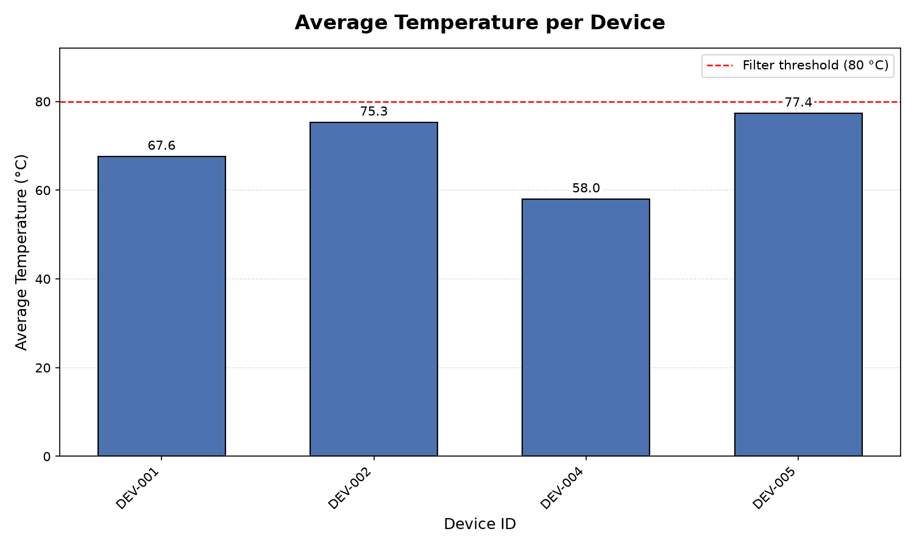

# Device Log Summarizer CLI

A Python command-line tool that cleans, summarises and visualises IoT device telemetry logs.



## Features

- **Data cleaning** – converts mixed sensor input to floats, drops invalid / `None` / negative values and caps readings at 500.0 (pure Python, no libraries).
- **Telemetry summary** – groups CSV logs by device, computes record count, average temperature and ERROR count, filters out devices averaging above 80 °C, and exports `output.json`.
- **Charting** – bar chart of average temperature per device with matplotlib.
- Graceful error handling for missing or invalid input files.

## Project structure

```
├── data_cleaner.py         # clean_sensor_data() + edge-case tests
├── telemetry_summary.py    # CSV → aggregated output.json + summary table
├── plot_temperatures.py    # output.json → temperature_chart.png
├── device_telemetry.csv    # sample data (15 rows, 5 devices)
├── PROMPT_LOG.md           # AI prompt log, incl. a chart bug and its fix
└── requirements.txt
```

## Getting started

Requires Python 3.8+.

```bash
git clone https://github.com/umang-162/device-log-summarizer.git
cd device-log-summarizer
python -m pip install -r requirements.txt
```

## Usage

Run the scripts in order:

```bash
python data_cleaner.py          # runs the data-cleaning tests
python telemetry_summary.py     # prints summary table, writes output.json
python plot_temperatures.py     # saves and shows temperature_chart.png
```

Use `python plot_temperatures.py --no-show` to save the chart without opening a window.

### Sample output

```
DEVICE LOG SUMMARY
+----------------------------------------------+
| Device ID  | Records | Avg Temp (C) | Errors |
+----------------------------------------------+
| DEV-001    |       3 |        67.63 |      1 |
| DEV-002    |       3 |        75.33 |      1 |
| DEV-004    |       3 |        58.03 |      1 |
| DEV-005    |       3 |        77.37 |      1 |
+----------------------------------------------+
Devices kept: 4
Filtered out (avg temp > 80.0): DEV-003 (91.67)
```

## Tech stack

Python 3 · `csv` · `json` · matplotlib
